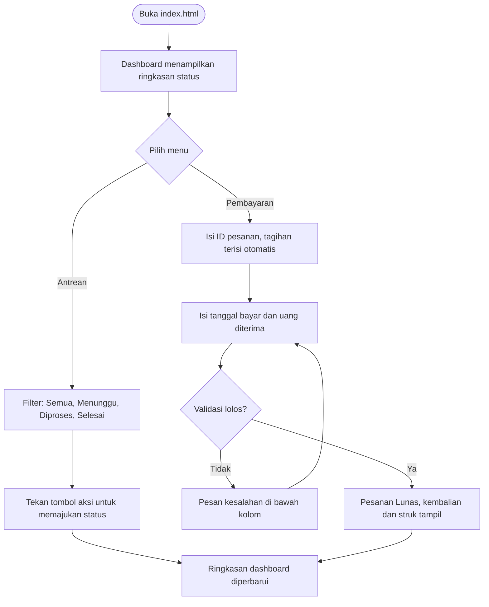

# CopyKuy - Dashboard Antrean dan Pembayaran Tunai

**UTS Pemrograman Web - Program Studi D4 Manajemen Informatika, Universitas Negeri Surabaya**

| | |
|---|---|
| Nama | Muhammad Wira Pratama |
| NIM | 25091397005 |
| Kelompok | 1 (kode kelompok: A01) |
| Dosen | Ari Kurniawan, S.Kom, M.T. |
| Topik | Sistem Website Fotokopi (CopyKuy) |

---

## 1. Deskripsi Project

CopyKuy adalah rancangan website layanan fotokopi dan print online untuk mahasiswa, sesuai proposal kelompok 1. Proyek ini adalah implementasi front-end UTS untuk bagian **dashboard antrean** dan **pembayaran tunai**.

Masalah yang dijawab: antrean di tempat fotokopi sulit dipantau, status pesanan tidak jelas, dan pencatatan pembayaran masih manual. Dengan aplikasi ini petugas dapat melihat ringkasan pesanan, menyaring antrean berdasarkan status, memajukan status pesanan, dan mencatat pembayaran tunai beserta kembaliannya.

Pembagian tugas UTS pada kelompok ini:

| Item | Berkas | Keterangan |
|---|---|---|
| 2.a Layout utama | `index.html` | Dashboard antrean, navbar, footer, navigasi AJAX |
| 2.b Fitur interaktif | `views/interaktif.html` | Filter antrean dan simulasi status |
| 2.c Form transaksi | `views/transaksi.html` | Form pembayaran tunai dengan validasi |

## 2. Fitur Aplikasi

**Layout dan dashboard (2.a)**
- Tampilan responsif (desktop dan HP), navbar dengan tombol menu untuk layar kecil.
- Ringkasan status: total pesanan, Menunggu, Diproses, Selesai, dan jumlah belum lunas. Angka ikut berubah saat data berubah.
- Navigasi AJAX: menu Antrean dan Pembayaran memuat halaman ke `#main-content` tanpa reload.

**Filter antrean (2.b)**
- Filter Semua, Menunggu, Diproses, Selesai, lengkap dengan jumlah pesanan pada tiap tombol.
- Simulasi status: Menunggu, lalu Diproses, lalu Selesai, lewat tombol aksi pada tiap baris.
- Label pembayaran Lunas atau Belum pada setiap pesanan.
- Tombol "Reset data demo" untuk mengembalikan data awal.

**Form pembayaran tunai (2.c)**
- Isian: ID pesanan, tanggal bayar, tagihan (otomatis), uang diterima, kembalian (otomatis).
- Validasi JavaScript/jQuery sebelum submit:
  - ID pesanan wajib, harus ada di data, dan belum lunas.
  - Tanggal bayar wajib.
  - Uang diterima wajib berupa angka dan minimal sama dengan tagihan.
- Kembalian = uang diterima - tagihan.
- Setelah sukses, pesanan berstatus Lunas dan struk singkat ditampilkan.

## 3. Struktur Folder Project

```
PWUTS_A01_25091397005/
├── index.html              # 2.a  Layout utama (dashboard, navbar, footer)
├── README.md               # 2.e  Dokumentasi
├── views/
│   ├── interaktif.html     # 2.b  Filter antrean dan simulasi status
│   └── transaksi.html      # 2.c  Form pembayaran tunai
└── assets/
    ├── css/
    │   └── style.css       # Gaya tampilan dan responsif
    ├── js/
    │   └── app.js          # Logika: AJAX, filter, status, validasi
    └── img/
        └── logo.svg        # Logo CopyKuy
```

## 4. Teknologi yang Digunakan

| Teknologi | Kegunaan |
|---|---|
| HTML5 | Struktur halaman dan form |
| CSS3 (Flexbox, Grid, media query) | Tampilan dan responsive web design |
| JavaScript dan jQuery 3.7.1 (CDN) | Interaksi, simulasi, validasi |
| jQuery AJAX `.load()` | Memuat 2.b dan 2.c ke layout utama |
| `localStorage` | Menyimpan data demo di browser |
| VS Code + Live Server / Python `http.server` | Server lokal untuk pengujian |
| Git dan GitHub | Pengumpulan hasil UTS |

## 5. Persiapan dan Cara Menjalankan

**Persiapan**
1. Browser modern (Chrome, Firefox, Edge, atau Safari).
2. Koneksi internet, karena jQuery dimuat dari CDN.
3. VS Code dengan ekstensi **Live Server** (Ritwick Dey), atau Python 3 sebagai alternatif.

**Menjalankan dengan Live Server**
1. Ekstrak proyek, lalu buka folder `PWUTS_A01_25091397005` di VS Code (File, Open Folder).
2. Klik kanan `index.html`, pilih **Open with Live Server** (atau tombol Go Live).
3. Browser terbuka di `http://127.0.0.1:5500/index.html`.

**Alternatif dengan Python**
```bash
cd PWUTS_A01_25091397005
python -m http.server 8000     # Windows: py -m http.server 8000
```
Lalu buka `http://localhost:8000`.

> Jangan membuka `index.html` dengan klik dua kali (`file://`). Browser memblokir AJAX `.load()` sehingga muncul pesan "Konten gagal dimuat".

**Contoh pengujian form pembayaran**
| Input | Hasil |
|---|---|
| ID `CK-001`, uang `20000` | Ditolak, uang kurang Rp10.000 |
| ID `CK-001`, uang `50000` | Berhasil, kembalian Rp20.000 |
| ID `CK-999` | Ditolak, ID tidak ditemukan |
| ID `CK-003` | Ditolak, sudah lunas |
| Tanggal dikosongkan | Ditolak, tanggal wajib diisi |

## 6. Alur Penggunaan Aplikasi



Alur status pesanan mengikuti proposal: `Menunggu` &rarr; `Diproses` &rarr; `Selesai`. Pembayaran tunai dapat dicatat kapan saja selama pesanan belum lunas.

**Alur pengumpulan ke GitHub (ketentuan UTS)**
1. Buat repository di akun GitHub, lalu letakkan folder `PWUTS_A01_25091397005` di dalamnya.
2. Jalankan perintah berikut dari folder induk:
```bash
git init
git add PWUTS_A01_25091397005
git commit -m "UTS Pemrograman Web - Wira Pratama"
git branch -M main
git remote add origin https://github.com/<id-github>/PWUTS_A01_25091397005.git
git push -u origin main
```
3. Buka URL repository di browser untuk memastikan semua berkas terlihat dan dapat diakses.

## 7. Catatan dan Batasan Aplikasi

- Aplikasi hanya front-end. Tidak ada backend dan basis data; data berupa contoh (`CK-001` sampai `CK-006`) yang disimpan di `localStorage` browser, sehingga berbeda tiap perangkat dan hilang jika cache dibersihkan.
- Atribut `action="proses_pembayaran.php"` pada form hanya penanda. Submit disimulasikan di `app.js`. Untuk server sungguhan, ganti dengan `$.post(...)` atau `this.submit()` di bagian yang diberi komentar.
- Tarif dan nama pelanggan adalah data ilustrasi dari proposal (Tabel 2.4), bukan harga sebenarnya.
- Pembayaran yang dicakup hanya tunai. Transfer, QRIS, unggah bukti, login, keranjang, dan dashboard admin pada proposal belum diimplementasikan.
- Jaringan diperlukan untuk memuat jQuery dari CDN. Tanpa internet, unduh jQuery dan ganti tag `<script>` di `index.html`.
- Fitur interaktif dan form sengaja berbeda dengan anggota lain (Zacky: kalkulator dan pemesanan; Hilda: estimasi dan pengambilan).

## 8. Repository GitHub

- URL: `https://github.com/<id-github>/PWUTS_A01_25091397005`
- Ganti `<id-github>` dengan akun GitHub yang didaftarkan ke dosen.
- Nama folder harus tepat `PWUTS_<kode_kelompok>_<nim>`. URL yang tidak sesuai ketentuan dan tidak dapat diakses dianggap tidak mengumpulkan UTS.

## 9. Penutup

Proyek ini menunjukkan penerapan HTML, CSS, dan JavaScript/jQuery pada kasus nyata: layout responsif, navigasi AJAX, fitur interaktif, dan form dengan validasi sebelum submit. Ke depan, antrean dan pembayaran dapat dihubungkan ke backend (PHP/Laravel dan MySQL) sesuai struktur basis data pada proposal, lalu ditambah login, keranjang, unggah file, dan dashboard admin.

Terima kasih kepada Bapak Ari Kurniawan, S.Kom, M.T. atas bimbingan pada mata kuliah Pemrograman Web, serta kepada rekan satu kelompok, Hilda Rizka Amrillah dan Mochammad Zacky Firmansyah.

---
*Muhammad Wira Pratama (25091397005) - D4 Manajemen Informatika, Universitas Negeri Surabaya, 2026*
